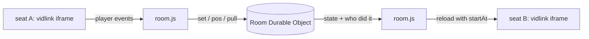

<div align="center">


### `TWO SEATS // ONE FILM // NO SCREEN SHARE`

*a film-sync room for two people in two places, run from one Cloudflare Durable Object*


-FF3DCB?style=flat-square&labelColor=111111)


</div>

---

## 🛋️ What is this

Watching a film over a video call means one laptop encodes the film live, uploads it, and runs a call on top. It is slow, it burns battery, and it heats the laptop. couch skips all of that: each browser plays its own copy, and only the play, pause and seek events travel between the two.

You open a room, both of you press **sit down**, and one of you pastes a film link from 1shows.org. The film loads on both sides. When one person pauses or skips, the other person's player reloads at the same second, with a toast saying who did it. When the film ends, you both land on a details page and rate it out of 5 blind, so nobody anchors the other (the argument after is the feature).

```console
nick@couch:~$ open https://couch.nicktrim.com
[✓] room made. bookmark it, send the link, sit down.
[i] the call stays on whatever you already use. headphones on.
```

## 🎬 The room

| | feature | what it actually does |
|---|---|---|
| 01 | **sit down** | one click per visit, which is also what lets the player autoplay with sound |
| 02 | **paste to play** | ⌘V a 1shows link anywhere in the room; mid-film it asks before switching |
| 03 | **remote control** | pause, play and seek reload the other player at `startAt`, behind a "syncing to 41:12" curtain |
| 04 | **the pill** | top right: who is here, the film, the clock, fullscreen; hides after 3 s |
| 05 | **drift badge** | more than 3 s apart turns the dot magenta with a resync button (no surprise reloads mid-scene) |
| 06 | **after the film** | backdrop, synopsis, director, runtime, then a blind 1 to 5 rating revealed when both have picked |
| 07 | **permanent room** | the room remembers the film and the position, so tomorrow resumes where you stopped |

## 🚀 Run it

Needs [Bun](https://bun.sh) and a Cloudflare account.

```bash
git clone https://github.com/nitrimandylis/couch.git
cd couch
bunx wrangler dev        # local, http://localhost:8787
bun check.ts             # two fake seats run through the whole protocol
bunx wrangler deploy     # change the route in wrangler.jsonc first
```

The deploy route points at couch.nicktrim.com, which you probably don't own.

## 🔩 Under the hood



vidlink's player reports what it does over `postMessage` but takes no commands, so moving someone means reloading their iframe at `?startAt=<seconds>`. It runs in JW mode (`player=jw`) because the default player restores its own saved time over `startAt`. A player event only counts as a person if it changes the room: a `play` while the room already plays is a buffer ending, not someone pressing play.

| file | path | job |
|---|---|---|
| worker | `src/worker.ts` | routes rooms, the Room Durable Object (state, relay, blind ratings), film details |
| room page | `public/room.html`, `public/room.js` | gate, player, pill, curtain, toasts, paste, end page |
| landing | `public/index.html` | makes a room with a random 10-character id |
| styles | `public/style.css` | cyan on blue-black, Space Grotesk and Space Mono, quiet motion |
| check | `check.ts` | two WebSocket seats: load, play, echo, blind rating, done |

Film details come from Wikidata and Wikipedia, plus IMDb when it answers (it refuses Cloudflare's servers, so in production it usually doesn't). No IMDb rating is shown, on purpose.

**Stack:** Cloudflare Workers · Durable Objects (SQLite, hibernating WebSockets) · plain HTML, CSS, JS · Bun

---

<div align="center">

**[Nick Trimandylis](https://github.com/nitrimandylis)**

`THE SCREEN SHARE IS DEAD. LONG LIVE THE PAUSE TOAST`

MIT licensed.

</div>
