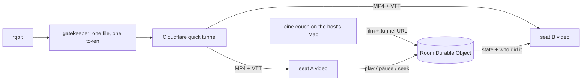

<div align="center">


### `TWO SEATS // ONE FILM // NO SCREEN SHARE`

*a film-sync room for two people in two places: the host's Mac streams the film, one Durable Object keeps time*


-FF3DCB?style=flat-square&labelColor=111111)


</div>

---

## 🛋️ What is this

Watching a film over a video call means one laptop encodes the film live, uploads it, and runs a call on top. It is slow, it burns battery, and it heats the laptop. couch skips all of that: the film is a plain MP4 file, both browsers play it in an ordinary `<video>`, and only play, pause and seek travel between the two.

The file comes from the host's Mac. [`cine couch`](https://github.com/nitrimandylis/cine) picks a film and a torrent every browser can play (MP4, H.264), streams it with rqbit, and puts it behind an anonymous Cloudflare quick tunnel that serves that one file and its English subtitles. The other person only opens the room link. When the film ends, you both land on a details page and rate it out of 5 blind, so nobody anchors the other (the argument after is the feature).

```console
nick@couch:~$ cine couch before sunrise
Before Sunrise is on in your couch room · https://couch.nicktrim.com/r/k3x9q7ab12
● in the room: Nick, Guest · streaming to them · 412 MB sent · downloaded · Ctrl-C to stop
```

## 🎬 The room

| | feature | what it actually does |
|---|---|---|
| 01 | **sit down** | one click per visit, which is also what lets the player start with sound |
| 02 | **the source** | `cine couch` on the host's Mac; the room plays whatever it sends, and holds the film paused if it stops |
| 03 | **remote control** | pause, play and seek are native `<video>` calls on the other side, exact to the frame |
| 04 | **the pill** | top right: who is here, the film, the clock, english subtitles per person, fullscreen; hides after 3 s |
| 05 | **drift badge** | more than 3 s apart turns the dot magenta with a resync button (no surprise reloads mid-scene) |
| 06 | **after the film** | backdrop, synopsis, director, runtime, then a blind 1 to 5 rating revealed when both have picked |
| 07 | **permanent room** | the room remembers the film and the position, so tomorrow resumes where you stopped |

## 🚀 Run it

Needs [Bun](https://bun.sh) and a Cloudflare account. The film side needs [cine](https://github.com/nitrimandylis/cine) with rqbit and cloudflared.

```bash
git clone https://github.com/nitrimandylis/couch.git
cd couch
bunx wrangler dev        # local, http://localhost:8787
bun check.ts             # two fake seats run through the whole protocol
bunx wrangler deploy     # change the route in wrangler.jsonc first
```

The deploy route points at couch.nicktrim.com, which you probably don't own.

## 🔩 Under the hood



One rule decides what counts as a person acting: a media event is only sent to the room when it disagrees with the room. A `play` while the room plays, or a seek that lands where the room is, is just the player following. If `cine couch` stops, the room pauses on an offline notice and keeps the film and its position; the same film coming back carries on from there.

| file | path | job |
|---|---|---|
| worker | `src/worker.ts` | routes rooms, the Room Durable Object (state, relay, blind ratings), film details |
| room page | `public/room.html`, `public/room.js` | gate, player, pill, subtitles toggle, curtain, toasts, end page |
| landing | `public/index.html` | makes a room with a random 10-character id |
| styles | `public/style.css` | cyan on blue-black, Space Grotesk and Space Mono, quiet motion |
| check | `check.ts` | two seats and a fake cine: load, play, echo, source loss and return, blind rating, done |

Film details come from Wikidata and Wikipedia by IMDb id, plus IMDb itself when it answers (it refuses Cloudflare's servers, so in production it usually doesn't). No IMDb rating is shown, on purpose.

**Stack:** Cloudflare Workers · Durable Objects (SQLite, hibernating WebSockets) · plain HTML, CSS, JS · Bun

---

<div align="center">

**[Nick Trimandylis](https://github.com/nitrimandylis)**

`THE SCREEN SHARE IS DEAD. LONG LIVE THE PAUSE TOAST`

MIT licensed.

</div>
